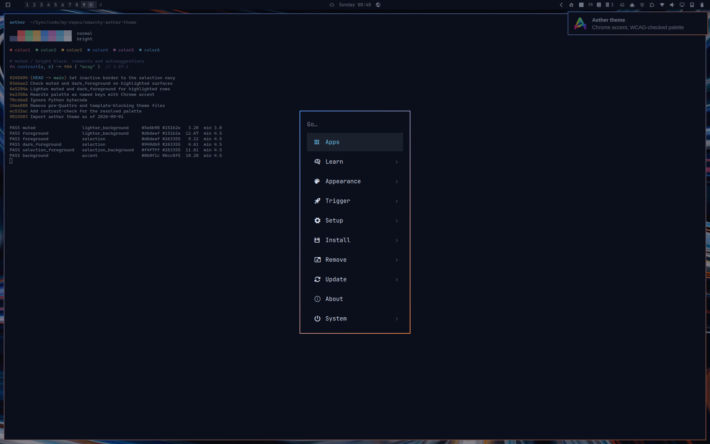

# Coldfire

A dark theme for [Omarchy](https://omarchy.org) with a charcoal background, cold blue and cyan accents, and one warm orange. The active window border runs from blue to orange, which is where the name comes from.



## Install

```bash
omarchy theme install https://github.com/GuppyTheCat/omarchy-coldfire-theme
```

The command clones the repo into `~/.config/omarchy/themes/coldfire` and applies the theme. Coldfire ships only a semantic `colors.toml`, so Omarchy generates the config for every themed app from its own templates.

## Palette

| Role | Hex |
| --- | --- |
| `background` | `#13161e` |
| `lighter_background` | `#1c2236` |
| `selection` | `#263355` |
| `muted` | `#5e6b98` |
| `foreground` | `#d6deef` |
| `accent`, `cyan` | `#6cc8f5` |
| `blue` | `#5b9cff` |
| `orange` | `#ff8a4c` |
| `red` | `#ff6b6b` |
| `yellow` | `#f5c26b` |
| `green` | `#7dd3a0` |
| `magenta` | `#d686d9` |

The full palette is in [`colors.toml`](colors.toml). The icon theme is Yaru-blue, and the wallpaper is [`backgrounds/1.jpg`](backgrounds/1.jpg).

## Blue command names in bash

The theme does not install this. With [ble.sh](https://github.com/akinomyoga/ble.sh), bash colors command names green by default. To color them with the theme's blue (ANSI color 4) instead, put these lines in `~/.config/blesh/init.sh`:

```bash
bleopt color_scheme=base16
ble-face -s command_file        'fg=4'
ble-face -s filename_executable 'underline,fg=4'
```

## Check contrast after editing colors

`.bin/contrast-check` reads the palette that Omarchy resolves from `colors.toml` and checks WCAG contrast ratios. Text on the background needs at least 4.5:1. Muted text needs at least 3:1 on both `background` and `lighter_background`. The script exits with 0 if every pair passes, 1 if any pair fails, and 2 if it cannot resolve the palette.

```bash
.bin/contrast-check
python3 -m unittest discover -s .bin -p 'test_*.py'
```
